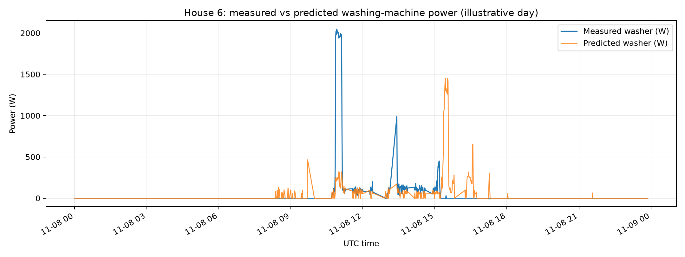

# REFIT model and usage findings - generated
**Data status:** `official_REFIT_analysis`

## Study design
Train Houses 1, 2; validation House 3; untouched test House 5. Data from one home cannot leak into another split.
Target: measured washer power. Inputs: aggregate-only causal history + UTC calendar features.
A detected washing-machine cycle has >20W active readings, permits up to 10 min idle within an event, lasts >=15 min and has >=3 active min.

## Model performance
|Split|Method|MAE (W)|RMSE (W)|Active MAE (W)|Active F1|Energy bias (%)|
|---|---|---:|---:|---:|---:|---:|
|validation_house3|always_off_baseline|4.3723|76.5287|351.3396|0.0|-100.0|
|validation_house3|random_forest|14.2884|96.1694|279.3231|0.2051|180.9|
|test_house5|always_off_baseline|10.4598|79.0333|138.7839|0.0|-100.0|
|test_house5|random_forest|18.2012|83.3441|130.0801|0.1477|7.38|

## Cross-house washing-machine EDA
|House|Actual UTC coverage|Observed minutes|Missing minutes|Off fraction|Detected cycles|Median cycle duration (min)|Median kWh/cycle|
|---|---|---:|---:|---:|---:|---:|---:|
|1|2014-09-01 16:55:00+00:00 to 2014-11-30 23:59:00+00:00|124390|5635|0.9856|17|21.0|0.0399|
|2|2014-09-01 00:00:00+00:00 to 2014-11-30 23:59:00+00:00|120576|10464|0.9573|99|22.0|0.0704|
|3|2014-09-01 16:55:00+00:00 to 2014-11-30 23:59:00+00:00|121682|8343|0.9639|77|23.0|0.0653|
|5|2014-09-01 00:00:00+00:00 to 2014-11-30 23:59:00+00:00|117080|13960|0.9181|131|30.0|0.0801|

## Interpretation of six required figures
1. Raw vs clean: compare aggregate, refrigerator and washer over the same 24-hour period; minute averages smooth high-frequency noise and missing outages should not be mistaken for observed zero.
2. The 24-hour aggregate+washer trace places one appliance load in the context of all other devices. The aggregate may have peaks unrelated to washing.
3. Cycle plot: the shaded interval is a **candidate** cycle defined by the explicit threshold/pause/duration rule; visual inspection is necessary.
4. Cross-home comparison: the absolute event counts and median kWh/event depend on sensor coverage and event thresholds. Do not interpret higher counts as higher monthly consumption without coverage normalization.
5. UTC hour/weekday plot: compare event starts across households. UTC hour is not identical to UK wall-clock hour during daylight saving.
6. Untouched House 5 actual vs predicted: RF overall MAE=18.2012 W versus always-off baseline=10.4598 W. Model error is higher or equal than the baseline. Inspect missed peak windows and false positives; the highlighted day is the highest-measured-activity evaluation day.

## Plots
See figures/01_raw_before_after.png through figures/06_actual_vs_predicted.png.

## Known failure modes
1. Dishwasher/kettle/heater signatures may overlap the washer signature, causing false positives.
2. In a new household, washer size/programs and other appliances differ from training homes, degrading performance.
3. Official prefilled zeros and Issues=1 flags can hide or invalidate ground truth.
4. Low-duty-cycle minute averaging can mask short on/off transitions.

## Business recommendation
Use cycle timing and kWh estimates to offer an opt-in off-peak shift suggestion only when tariffs support it.
Measure opt-in rate, shifted kWh, bill changes and estimated-usage error against a control group.
Do not imply all load shifting saves energy (kWh); it may only lower cost or peak demand.

## Limitations
These houses are UK properties with ~8-second source readings; household differences, missingness and UK-to-India transfer limit generalization.
At 15/30-minute resolution, brief peaks collapse into averages, making event boundaries and precise cycle duration difficult to recover.

<!-- EXTENDED_REFIT_HOUSE6_EVALUATION -->

## Extended evaluation: validation-selected method and House 6 holdout

Train: Houses 1 and 2; validation/model selection: House 3; new independent holdout: House 6 (Appliance2). Date window: 2014-09-01 through 2014-12-01 (end exclusive, UTC).

**Method selected by validation F1:** `Original RF + 50W cutoff`. The two-stage classifier/regressor was **rejected** because no tested threshold beat this F1 on House 3.

### House 6 results

| Method | MAE (W) | Active MAE (W) | Precision | Recall | F1 | Energy bias (%) |
|---|---:|---:|---:|---:|---:|---:|
| Always off | 3.12 | 319.20 | 0.000 | 0.000 | 0.000 | -100.00 |
| VALIDATION-SELECTED: Original RF + 50W cutoff | 5.39 | 237.75 | 0.217 | 0.500 | 0.303 | +27.45 |

Interpretation: the selected method improves active-minute MAE (319.20 to 237.75 W), but overall MAE is worse (3.12 to 5.39 W). Precision 0.217; recall 0.500; F1 0.303; energy bias +27.45%. Not deployment-ready.

### Scientific caveats

House 5 was the initial held-out evaluation, but was subsequently examined; it is **not** a fresh holdout for later model changes. House 3 was used in iterative exploratory comparisons, so model-selection optimism is possible. House 6 was evaluated after model selection and should not be used for further tuning. The test set does not establish broad deployment reliability.

### House 6 actual-versus-predicted plot

